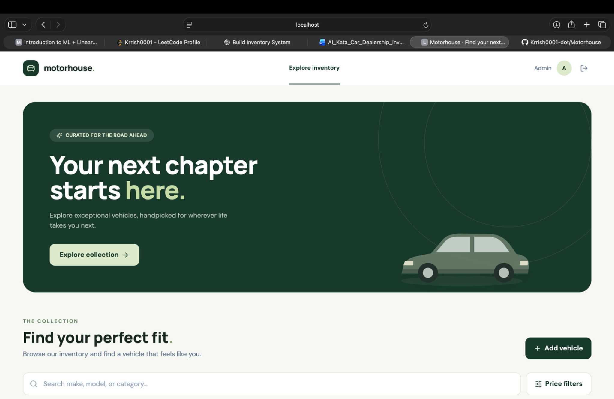
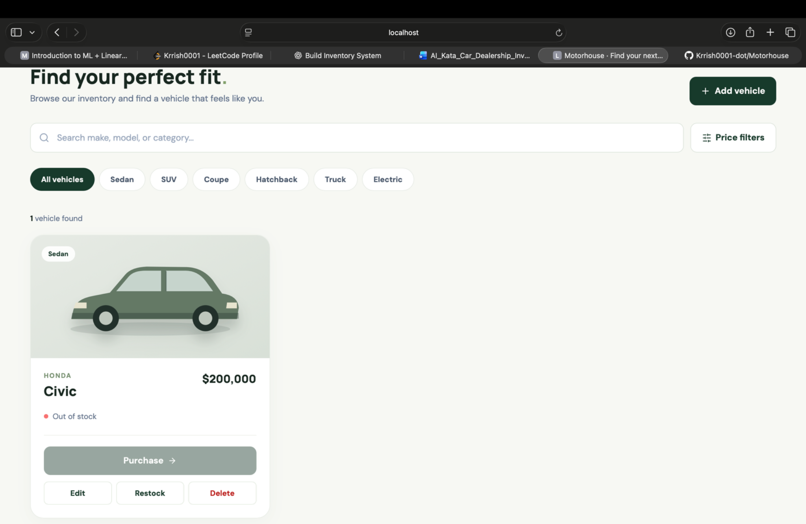
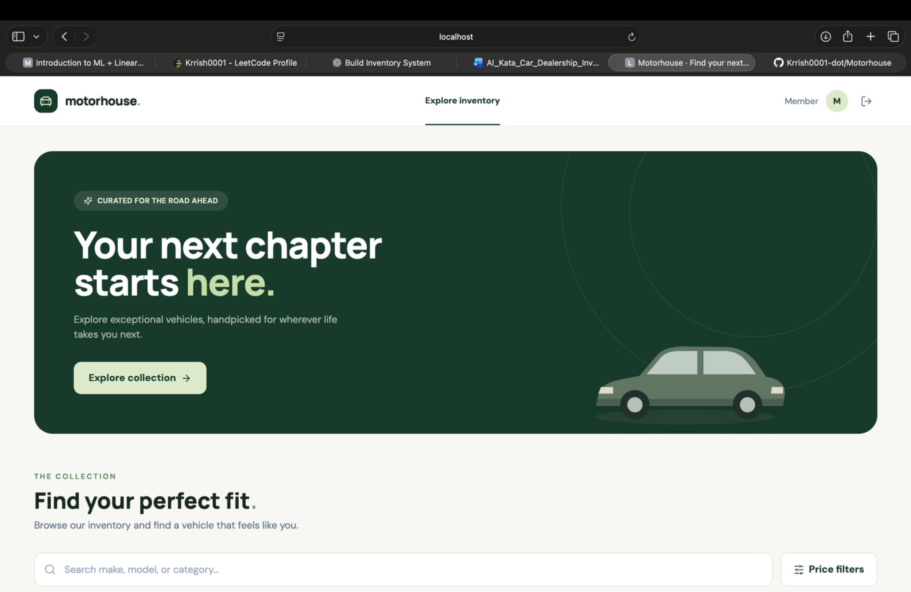

# Motorhouse — Car Dealership Inventory

Motorhouse is a full-stack inventory kata with an Express/MongoDB Atlas REST API and a React/Tailwind single-page application. Members can browse, filter, and purchase vehicles; admins can also add, edit, restock, and delete them. Purchase changes inventory only; there is no payment integration.

**Stack:** Node.js, Express, MongoDB Atlas, JWT, React, Vite, Tailwind CSS, Vitest, and Node's test runner. The repository has separate `backend/` and `frontend/` packages.

## Current REST API

| Method | Path | Result |
| --- | --- | --- |
| `POST` | `/api/auth/register` | Creates a member or invite-code admin (`201`), rejects invalid input (`422`), wrong invite (`403`), or duplicate email (`409`) |
| `POST` | `/api/auth/login` | Returns a 12-hour JWT bearer token (`200`), or `401` |
| `GET` | `/api/auth/me` | Returns the token holder's public profile (`200`), or `401` |
| `GET` | `/api/vehicles` | Lists all vehicles, including out-of-stock items (authenticated) |
| `GET` | `/api/vehicles/search` | Filters by `make`, `model`, `category`, `min_price`, `max_price` (authenticated) |
| `POST` | `/api/vehicles` | Adds a vehicle (admin only) |
| `PUT` | `/api/vehicles/:id` | Updates supplied fields (admin only) |
| `DELETE` | `/api/vehicles/:id` | Deletes a vehicle (admin only) |
| `POST` | `/api/vehicles/:id/purchase` | Decreases stock by one; returns `409` when out of stock (authenticated) |
| `POST` | `/api/vehicles/:id/restock` | Adds a positive whole `quantity` to stock (admin only) |
| `GET` | `/api/health` | Public health response for Railway (`{"status":"ok"}`) |

Passwords use bcrypt hashes. The database has a unique email index. The server assigns the admin role only when `admin_code` matches the private `ADMIN_INVITE_CODE`; a client-supplied `role` is ignored. MongoDB Atlas is the persistent database; tests inject fake stores to verify HTTP behavior without Atlas credentials. The local browser check confirmed registration, vehicle creation, price update, and purchase with the user's Atlas cluster.

Vehicles have a generated MongoDB ID, make, model, category, price, and quantity. Add a vehicle with JSON such as `{"make":"Honda","model":"Civic","category":"Sedan","price":19000.50,"quantity":2}` and an admin bearer token. Prices are stored as integer cents to avoid floating-point stock prices; the API returns numeric prices. Search text matches case-insensitive substrings and combines supplied filters. Invalid details return `422`, missing vehicles `404`, and non-admin writes `403`. The full collection is returned without pagination at this kata stage.

Purchase is an atomic conditional MongoDB update that decrements only when `quantity > 0`; it returns the updated vehicle. The frontend asks for confirmation before sending the purchase request; Cancel leaves inventory unchanged. Restock accepts JSON such as `{"quantity":3}` and atomically increments stock. Both operations return the updated quantity. No payment processing is performed in this kata.

## Backend structure (MVC)

| Folder | Responsibility |
| --- | --- |
| `backend/src/routes/` | Declare REST paths and attach middleware/controllers |
| `backend/src/controllers/` | Handle API behavior and HTTP responses |
| `backend/src/models/` | Read and write MongoDB documents |
| `backend/src/views/` | Serialize public JSON without database-only fields |
| `backend/src/middleware/` | Authentication, admin authorization, async/error handling |
| `backend/src/validation/` | Parse vehicle payloads and search filters |

`app.js` wires the pieces together; `server.js` connects to Atlas. Since this is a JSON API, its views are response serializers rather than HTML templates. The refactor preserves the existing endpoint contract.

## Local setup

1. Create a MongoDB Atlas cluster, a database user, and a Network Access rule that permits your development machine. Copy its Node.js connection string.
2. Copy `backend/.env.example` to `backend/.env`, replace `MONGODB_URI` with your Atlas URI, and set private random values for `JWT_SECRET` (at least 32 bytes) and `ADMIN_INVITE_CODE`. The `.env` file is ignored by Git. Never commit it or paste its values into an issue or screenshot.
3. From the repository root, run the backend:

```bash
cd backend
npm ci
npm test
npm run dev
```

The API listens at `http://localhost:8000`. Tests do not require Atlas credentials; the server does. `GET http://localhost:8000/api/health` should return `{"status":"ok"}` after startup.

4. Keep the backend running. In a second terminal from the project root, run:

```bash
cd frontend
npm ci
npm test
npm run dev
```

Open `http://localhost:5173`. The frontend sends requests to `http://localhost:8000` by default. For another API address, set `VITE_API_URL` in the frontend environment before starting Vite. The backend CORS origin defaults to `http://localhost:5173`; adjust `FRONTEND_ORIGIN` in `backend/.env` if you change the frontend origin. Run `npm run build` in `frontend/` to check the production bundle. The invite code is entered in the registration form and is never embedded in the frontend source. Register with the code from your private `backend/.env`, sign in, and use **Add vehicle** to populate an empty collection. Admin accounts see edit, restock, and delete actions on each vehicle; members do not.

`npm ci` may report dependency advisories. Use `npm audit` to inspect them before changing versions; the frontend audit observed eight advisories in this development snapshot. Several fixes require major build-tool upgrades; do not apply `npm audit fix --force` without testing the upgrade and checking your Node.js version.

Register your admin account by including the code from your private `.env` file:

```json
{"email":"you@example.com","password":"your-long-password","admin_code":"your-private-code"}
```

You can enter these details in the React registration form or send that JSON to `POST /api/auth/register`.

## Deploy: Railway API and Vercel frontend

1. Push this repository to GitHub **without** `backend/.env` or any secrets. Create a Railway service from the GitHub repository and set its **Root Directory** to `backend`. Use `npm start` as the start command and `/api/health` as the healthcheck path. Railway assigns the runtime `PORT`; do not hardcode it.
2. Set Railway service variables `MONGODB_URI`, `MONGODB_DB_NAME` (for example `motorhouse`), `JWT_SECRET` (at least 32 bytes), and `ADMIN_INVITE_CODE`. Configure Atlas Network Access so Railway's outbound connection can reach the database. Generate a public Railway domain and verify `https://YOUR-API-DOMAIN/api/health` returns `{"status":"ok"}`.
3. Create a Vercel project from the same GitHub repository. Set its **Root Directory** to `frontend`, framework to **Vite**, build command to `npm run build`, and output directory to `dist`. Set the build environment variable `VITE_API_URL` to your Railway HTTPS domain **without a trailing slash**. Deploy and note the production Vercel URL.
4. Back in Railway, set `FRONTEND_ORIGIN` to that exact Vercel origin (for example `https://motorhouse.example.vercel.app`, **no trailing slash**) and redeploy the API. Open the Vercel site and verify login, inventory loading, and an admin action. Vercel preview URLs have different origins; this configuration allows the chosen production origin.

The frontend reads `VITE_API_URL` at **build time**, so changing it requires a new Vercel deployment. `FRONTEND_ORIGIN` is a runtime Railway variable. The admin invite code and JWT secret belong **only** in Railway, never in Vercel's `VITE_` variables. See [Railway's monorepo guide](https://docs.railway.com/deployments/monorepo) and [Vercel's build configuration](https://vercel.com/docs/builds/configure-a-build) for the current platform controls.

## Screenshots

These screenshots were captured from the locally running app after the search field fix. They show the admin dashboard, an out-of-stock vehicle with Purchase disabled, and the member dashboard.







## TDD progress

The Git history contains failing tests before the authentication, vehicle CRUD, inventory, frontend, and deployment health-check implementations. Backend tests use Node's built-in test runner and Supertest; Mongo adapter tests cover search and conditional purchase updates. Frontend tests use Vitest and Testing Library. Run `npm test` in each package and `npm run build` in `frontend/`. See `TEST_REPORT.md` for results and `PROMPTS.md` for the conversation record status.

## My AI Usage

I used OpenAI Codex to draft backend authentication and inventory tests, implement and refactor the Express/MongoDB API into MVC layers, write frontend interaction tests and React/Tailwind components, debug UI behavior from screenshots, and prepare this documentation. I reviewed the behavior by running both test suites and the frontend production build. I also manually checked the local Atlas-backed flows with the assistant's guidance: admin registration, create, edit, and purchase; the member view works locally.

AI sped up the red–green cycles and helped catch gaps such as atomic stock decrement and purchase confirmation. It also generated initial code that needed human feedback: the search icon overlapped its input until it was seen in the browser. The tests use injected stores and mocked HTTP, so platform deployment and final browser checks remain necessary. The raw, unedited chat log or a public chat link belongs in `PROMPTS.md` before submission. **The kata requires AI co-author trailers on AI-assisted commits; audit and correct commit metadata before publication.**
